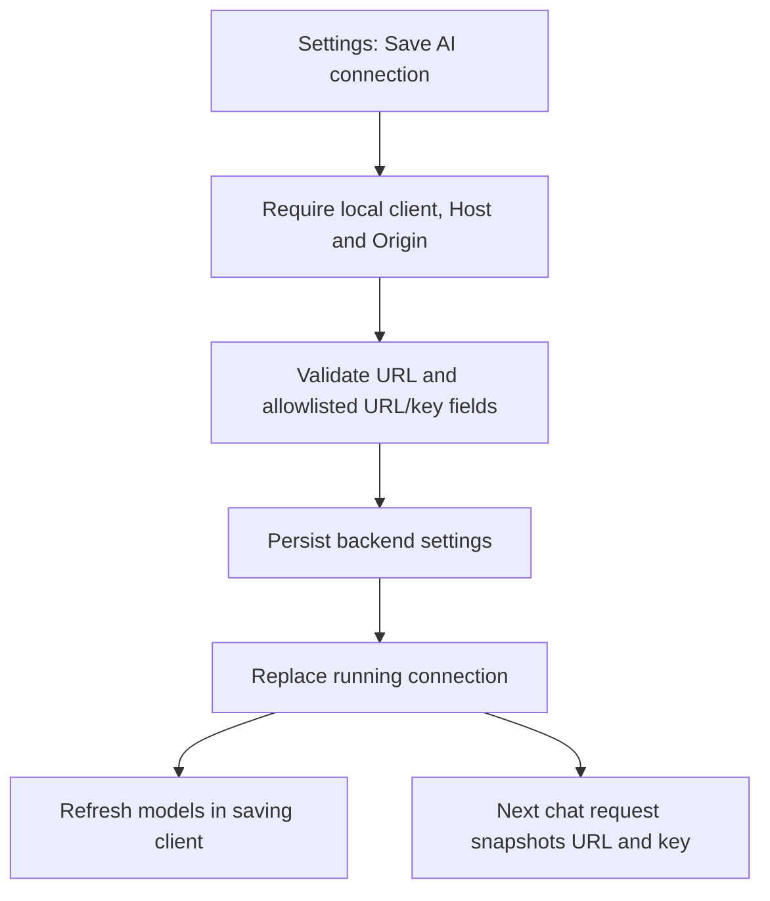

# AI chat connection settings result

## Before and after

| Behavior | Before | After |
| --- | --- | --- |
| URL/key controls | Desktop Settings only | Browser and desktop Settings |
| Applying a saved connection | Restart required | Next request uses saved connection |
| Saved API key | Masked; blank preserves it | Same behavior, backend only |
| Chat model picker | In chat | Still in chat; provider models refresh after save |

## Implementation flow

Failed persistence leaves the running connection unchanged. Requests already running finish using their original connection. Responses never return the stored API key. Other clients using the backend use the updated connection on subsequent requests; automatic model-list refresh is triggered in the client that saved.

## Verification evidence

- Test-first implementation and focused response-error regression test both demonstrated failures before fixes.
- Frontend: 142 tests passed, 2 skipped; lint passed; production build passed with the existing bundle-size warning.
- Backend: 26 tests passed, including an in-flight chat crossing a save, invalid inputs, unrelated settings, malicious origins, non-local clients, and rebinding Hosts.
- Browser and real HTTP with a fake AI provider proved URL/key visibility, blank-key preservation, reload persistence, masked keys, provider model refresh, immediate chat routing, and untrusted-Origin rejection. English and Traditional Chinese labels were inspected.
- Local E2E evidence: `.tmp/verify-stock-analysis-platform/ai-connection-build-it/evidence.md`, screenshots, snapshots, HAR, and fake-provider request log. Owned test services and browser were stopped.
- Final whitespace check passed. Implementation remains uncommitted; planning checkpoint is `395221a`. Spec is published as issue #2.

## Independent reviews and judgment calls

Standards review passed after round 2. Spec review passed in round 1 with no findings.

The old backend invariant said all settings routes were desktop-only, which conflicted with the explicitly approved browser feature. The rule now preserves the desktop-only general settings route and names the local-only AI connection exception. This resolves the conflict without exposing IB settings.

Small repeated access guards and validation at the persistence boundary were retained. A shared response-helper module was unnecessary; the settings parser now provides localized errors for malformed responses. Reviewers accepted these as nonblocking judgment calls. Nested form classes do not duplicate padding.

Web mode now consistently reads and saves `backend/.env` unless ENV_FILE is supplied, including when launched from another working directory. This supports persistence at the same file used at startup. The legacy desktop settings endpoint remains restart-only for older clients; the new AI form uses the immediate-apply endpoint.

## Limitations

This feature assumes a local browser or desktop app connected to its backend. Static GitHub Pages and remote administration are outside scope. A default model must already be configured, as before. Real provider integration, packaged Electron, and the full chart-to-chat browser send path were not checked. No irreversible data migration or new dependency was introduced. Changing the service URL changes the destination of the configured API key.

